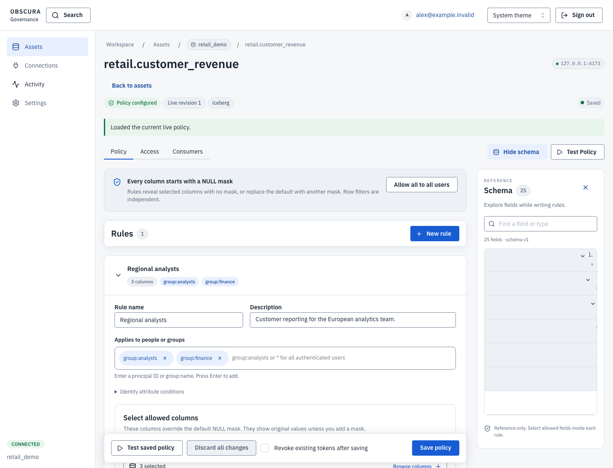
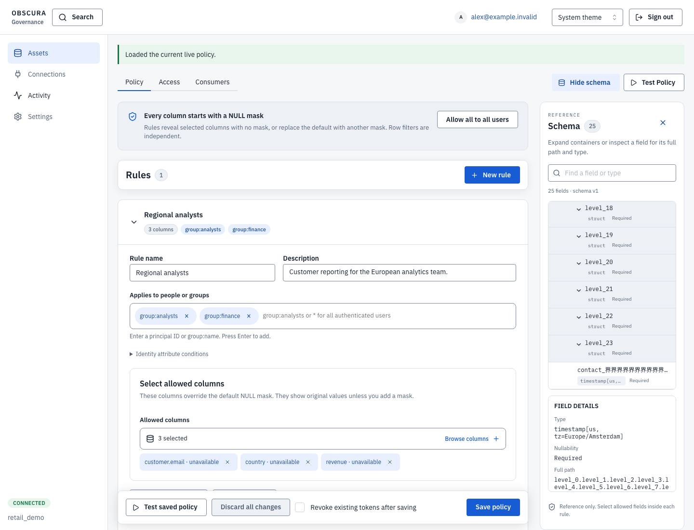
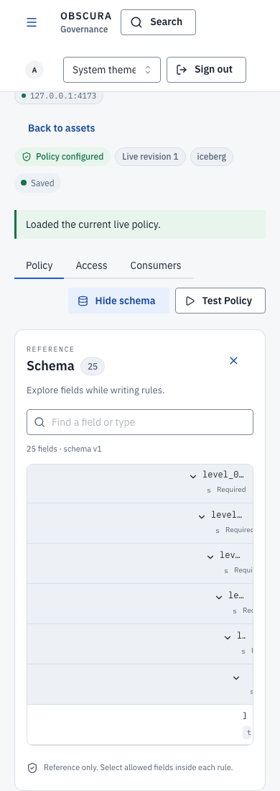
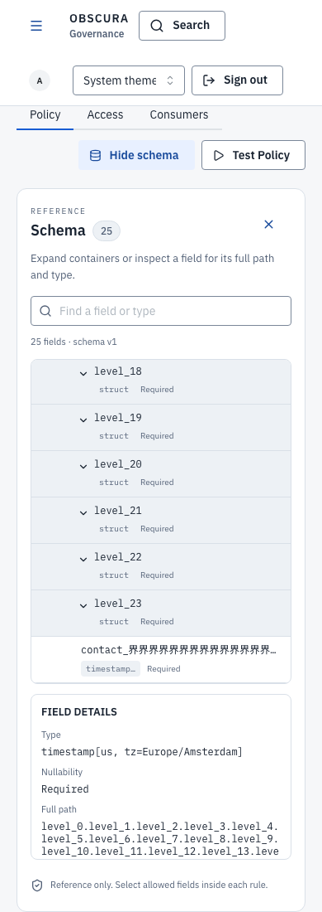

# Schema reference inspection

The before captures use commit `f500b155` production UI. The after captures use
this delivery. Both run the same authenticated synthetic reference fixture with
24 struct levels, a 1,024-character Unicode suffix, and a literal dotted leaf
name. This is rendered UI evidence, not live-provider or deep Arrow execution
qualification. The source schema is substituted while policy rule data remains
unchanged; unavailable rule-column tags are part of that fixture in both phases.

Previously, indentation consumed almost the entire mobile row and full values
were accessible only through hover titles. Indentation now stops at 48 pixels;
deep rows display the exact leaf name, with full ancestry available in inspection.
Native disclosure buttons keep expansion separate from allowed-column editing.
Leaf inspection uses a keyboard-operable button and a focusable, scrollable detail
region containing the exact name, human path, type, and nullability. Display
ellipsis never becomes field identity, and inspection sends no policy writes.

The interaction stays a disclosure list. We did not add tree roles without their
required keyboard/group/focus model. The
[W3C tree-view pattern](https://www.w3.org/WAI/ARIA/apg/patterns/treeview/)
provides the reference for a future complete tree navigator. Search followed by
Tab and Enter/Space reaches otherwise hidden leaves in the current reference UI.

Desktop before:



Desktop after:



Mobile before:



Mobile after:



Behavioral checks cover exact Unicode/literal path values, keyboard inspection
and detail scrolling, readable row width, no horizontal page overflow, focus,
no writes, and automated accessibility at 1440, 390, and 320 pixels. Existing
schema expansion/scroll checks and 10,000-field virtualization/search checks pass.
The synthetic 20,000-level flattening test only proves JavaScript stack safety;
the service's native depth and schema admission limits remain unchanged.

Captures are separate from correctness tests:

```bash
pnpm --dir apps/governance-ui capture:review schema-reference-review.spec.ts
```

Before capture requires the baseline UI with this delivery's review fixture;
set `DAL_OBSCURA_REVIEW_PHASE=before`. The current UI defaults to the after phase.
